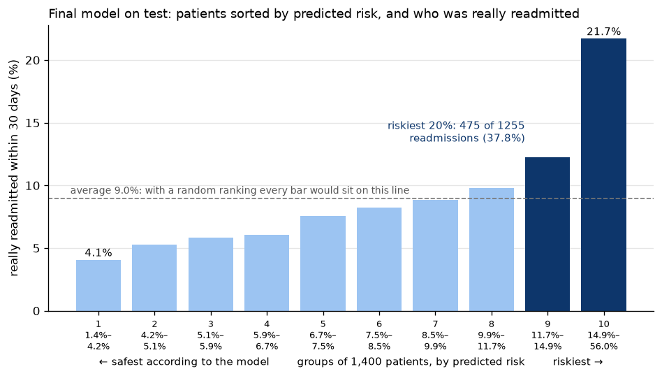
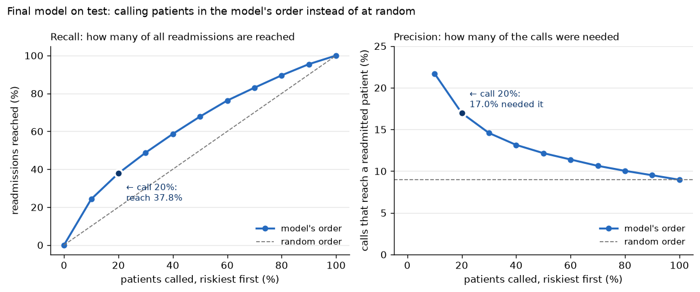
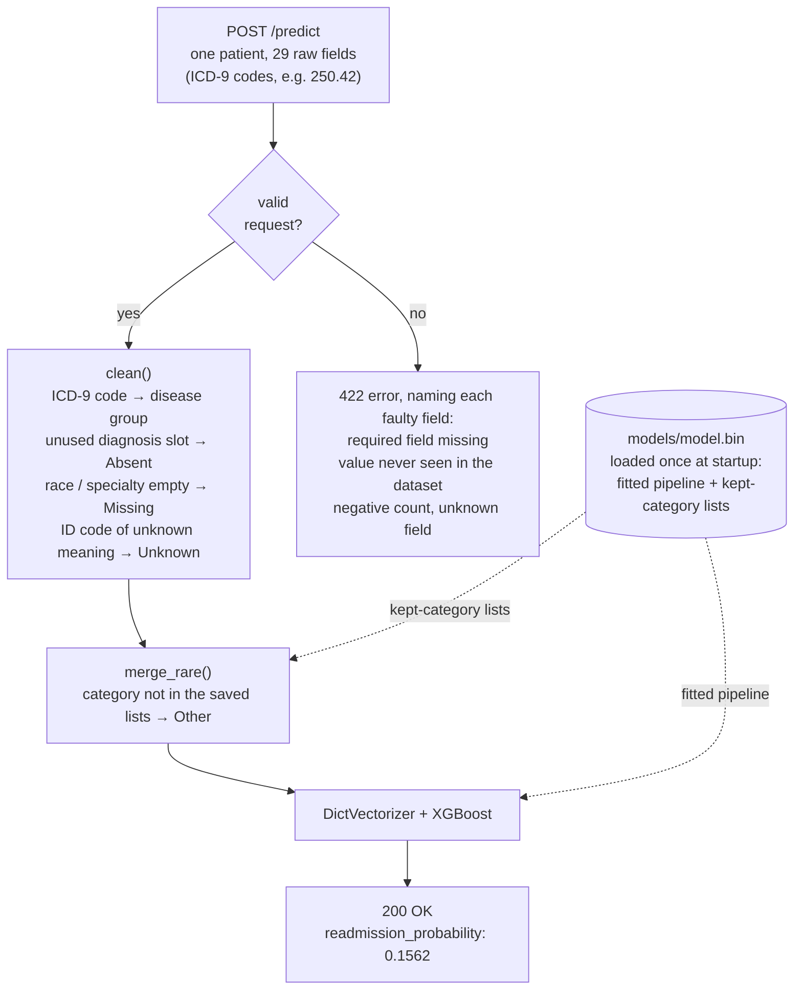

# Diabetes 30-day readmission

Predict whether a diabetic patient will be readmitted to hospital **within 30 days** of discharge, from the data of the hospital stay. ML Zoomcamp 2026 midterm project.

**Result:** an XGBoost model with a test AUC of **0.649**. The 20% of patients it ranks riskiest contain 38% of all
readmissions, almost twice what a random choice would reach. Served with FastAPI, containerised with Docker and
deployed on a local Kubernetes cluster.

## Problem

Hospitals in the US are penalised for early readmissions (Hospital Readmissions Reduction Program), and a readmission within 30 days is often a sign that the patient left hospital without enough support.

**Use case.** On the day of discharge, the model gives each diabetic patient a probability of being readmitted within 30 days. The hospital's care-transition team (nurses, case managers, pharmacists) cannot call, visit or review the medication of every patient, so it uses the score to rank the day's discharges and spend its limited capacity on the patients most likely to come back.

- **Target:** `readmitted == '<30'` (binary; 9.0% of the encounters after scoping). Readmissions after 30 days count as negative.
- **Metric:** ROC AUC, because the team acts on a ranking and the classes are imbalanced (always predicting "no readmission" is already 91% accurate).
- **Features:** only information available at discharge (demographics, admission data, length of stay, lab results, medications and their changes during the stay, diagnoses).
- **Bar in practice:** hospitals already use simple clinical scores such as the LACE index for this task (see [How good is the model?](#how-good-is-the-model)).

## Data

[Diabetes 130-US Hospitals for years 1999–2008](https://archive.ics.uci.edu/dataset/296) (UCI Machine Learning Repository, dataset 296): 101,766 hospital encounters of 71,518 patients across 130 US hospitals, 50 columns.

- Licence: [CC BY 4.0](https://creativecommons.org/licenses/by/4.0/). The raw files are committed in `data/raw/`.
- Source paper: Strack B. et al. (2014), *Impact of HbA1c Measurement on Hospital Readmission Rates: Analysis of 70,000 Clinical Database Patient Records*, BioMed Research International, [doi:10.1155/2014/781670](https://doi.org/10.1155/2014/781670).

| File | Content |
| --- | --- |
| `data/raw/diabetic_data.csv` | one row per encounter |
| `data/raw/IDS_mapping.csv` | meaning of `admission_type_id`, `discharge_disposition_id`, `admission_source_id` |

To download them again: `uv run python scripts/download_data.py`.

### Scoping rules

Following the source paper:

1. **One encounter per patient**, so the same patient cannot appear in both training and validation data.
2. **Drop encounters that ended in death or hospice** (`discharge_disposition_id` 11, 13, 14, 19, 20, 21): these patients cannot be readmitted.
3. **Group the ICD-9 diagnosis codes** (`diag_1`, `diag_2`, `diag_3`) into about 9 disease categories.

Rule 1 uses the lowest `encounter_id` as the first encounter (the data has no dates; the notebook checks that the id order is consistent with time order). The 3 rows with `gender` = `Unknown/Invalid` are also dropped. Result: **69,970 encounters**, one per patient (the paper reports 69,984; the difference of 14 rows, 0.02%, is documented in the notebook).

## Exploratory data analysis

[`notebooks/01_scoping_eda.ipynb`](notebooks/01_scoping_eda.ipynb). The patients are split 60/20/20 into train,
validation and test, stratified on the target, and every analysis that shapes a decision runs on the training set only.

- **Missing values hide in three forms:** `?` in seven columns, coded "unknown" IDs (`NULL`, `Not Mapped`, …) in the
  three ID columns, and `Unknown/Invalid` in `gender`. `None` in the two lab tests looks similar but is not missing: it
  means the test was not done, and stays a category. `weight` (96% missing) and `payer_code` (44%) are dropped.
- **An empty diagnosis is not always missing:** every patient with one diagnosis has empty `diag_2` and `diag_3`. Those
  slots are "Absent" (no such diagnosis); only the remaining empty codes are "Missing".
- **Each feature is weak on its own:** the best numeric feature, `time_in_hospital`, reaches an AUC of only 0.566 as a
  score by itself, followed by the number of previous inpatient stays (0.546). The model has to combine many weak
  signals, so a modest AUC was expected from the start.
- **The most informative categorical columns** (mutual information) are `discharge_disposition_id` (where the patient
  goes after discharge), `medical_specialty` and `age`.
- **Recording artefacts:** `number_diagnoses` is capped at 9 and `num_procedures` has a "6 or more" bucket. Trees handle
  both with a single split.
- **A1C test:** tested patients are readmitted slightly less (8.4% vs 9.1%), but the gap depends on the primary
  diagnosis. This is an association only: doctors decide who is tested, so it does not show that testing lowers
  readmission.
- **Two feature sets go to modelling:** all 41 inputs, and a reduced list of 29 without the 11 drugs where 99%+ of
  patients have the same value, and without `gender` (no information about the target).

## Modelling and results

[`notebooks/02_modelling.ipynb`](notebooks/02_modelling.ipynb), on the same split as the EDA. Rare categories (fewer
than 100 training patients) are merged into "Other", with the lists learned on the training set only.

**Decision rule, fixed before training any model:** a more complex option (more columns, a transformation, a larger
model, an ensemble) is kept only if it raises the validation AUC by more than **0.005**. The margin was set in advance
as a judgement and confirmed in section 4.2: changing only the random seed moves the random forest by up to 0.0048.

Every model is tuned before the comparison, with loops over its main hyperparameters on the fixed validation set, as in
the course (`GridSearchCV`, a cross-validated search, would be the production way):

| Model | Tuned | Best settings | Validation AUC |
| --- | --- | --- | --- |
| Logistic regression | `C` from 0.001 to 10; `log1p` on the 6 skewed counts | `C` = 1, plain counts | 0.6510 |
| Decision tree | `max_depth` × `min_samples_leaf` | depth 8, leaf 200 | 0.6305 |
| Random forest | `max_depth` × `n_estimators`, then `min_samples_leaf` | depth 15, leaf 5, 200 trees | 0.6553 |
| XGBoost | learning rate (AUC per round), `max_depth` × `min_child_weight`, rounds | rate 0.05, depth 4, child weight 30, 400 rounds | **0.6597** |

- **XGBoost is the only model above the margin:** +0.0087 over the logistic regression. On the same validation patients,
  resampled 1,000 times, the gain is +0.0087 ± 0.0045.
- **Reduced list:** 0.6569, −0.0028 against all columns, inside the margin, so the final model uses the **29 inputs**.
- **Soft vote** (average of logistic regression, random forest and XGBoost): 0.6612, only +0.0016 over XGBoost alone.
  Not kept: one model is simpler to ship and maintain.
- **SVM not tried:** a linear SVM behaves like the logistic regression, and a kernel SVM does not scale to 42,000
  training patients.

**Final model:** XGBoost (learning rate 0.05, depth 4, `min_child_weight` 30, 400 rounds) on 29 inputs, retrained on
train + validation (55,976 patients) and scored **once** on the test set:

| Estimate | AUC |
| --- | --- |
| Validation (the set every choice was made on) | 0.6569 |
| 5-fold cross-validation on train + validation | 0.6524 ± 0.0152 |
| **Test** (13,994 patients never used before) | **0.6493** |

The scores fall in the expected order: validation is the most optimistic because every choice was tuned on it, and the
test score is the one to quote. It is not compared with the logistic regression's 0.651, which was measured on
different patients; the comparison on the same patients is the +0.0087 above.

## How good is the model?

**What 0.65 means.** Take one readmitted and one not-readmitted patient at random: the model gives the readmitted one
the higher risk 65% of the time (50% would be a coin toss, 100% a perfect ranking).

**What it is worth in practice.** The test patients are sorted by predicted risk and cut into 10 groups of about 1,400.
The real readmission rate rises from 4.1% in the safest group to 21.7% in the riskiest, against a 9.0% average:



For the care-transition team the question is what a call budget buys. Calling the riskiest 20% of patients (2,799
calls) reaches 475 of the 1,255 readmitted patients: a **recall** of 37.8%, against 20% in random order. 17.0% of those
calls go to a patient who is really readmitted (**precision**), almost twice the 9.0% of random calls. Calling more
patients reaches more readmissions but wastes more calls; the budget, not the model, sets the cut-off.



**Why not higher?**

- **Four different models end within 0.03 of each other** (0.631 to 0.660): the limit is the information in the data,
  not the algorithm.
- **The main drivers of readmission are not in the data:** support at home, follow-up visits after discharge, adherence
  to treatment, lab values and vital signs at discharge, and readmissions to other hospitals.
- **Published models do no better on similar data.** A systematic review of 26 readmission models (Kansagara et al.,
  [*JAMA* 2011;306(15):1688–1698](https://doi.org/10.1001/jama.2011.1515)) found that most perform poorly: models built
  on retrospective administrative data and tested in large US populations reach C statistics (= AUC) of 0.55 to 0.65,
  while models using clinical data available at discharge reach 0.68 to 0.83. The LACE index reported a C statistic of
  0.684 at its validation (van Walraven et al., [*CMAJ* 2010;182(6):551–557](https://doi.org/10.1503/cmaj.091117)),
  for a related but different outcome (death or unplanned readmission within 30 days, in Ontario). This model's 0.649
  sits at the top of the administrative-data range.

**Use it to prioritise, not to decide.** The ranking is good enough to choose which patients get a follow-up call
first. It is not precise enough for decisions about a single patient: 62% of readmissions fall outside the riskiest
20%, and 78% of the patients in the riskiest tenth are not readmitted.

## Setup

Requires [uv](https://docs.astral.sh/uv/). `uv sync` creates the virtual environment in `.venv` with the locked
versions; commands can then be run with the `uv run` prefix, as below, or after activating the environment with
`source .venv/bin/activate`.

```bash
uv sync                                                        # runtime + dev (notebook, tests) dependencies
uv run python -m diabetes_readmission.train                    # retrain, print the test AUC, save models/model.bin
uv run pytest -q                                               # unit and API tests
uv run uvicorn diabetes_readmission.predict:app --port 9696    # start the service; try it at localhost:9696/docs
```

The notebooks run on the same environment: select the `.venv` kernel in VS Code or Jupyter.

## Prediction service

`src/diabetes_readmission/predict.py` is a FastAPI service that scores one discharged patient per request. The request
holds the raw fields of the hospital record; the service prepares them with the same code as training
(`features.py`), so a patient sent to the API is treated exactly like the patients the model learned from.



**Required and optional fields.** `race`, `medical_specialty` and `diag_1` to `diag_3` may be left out or sent as
`null`: they are often not recorded in the hospital data too (`medical_specialty` is empty for about half of the
patients), so the model has learned what "not recorded" means for them. Every other field is required, and a request
without one is rejected with a 422 error naming the missing fields. The training data has no missing values in those
fields, so the model has never seen a patient without them, and filling in a guessed value would silently change the
risk it returns.

**Reading the answer.** `readmission_probability` is the predicted chance of a readmission within 30 days. The average
patient is at about 9%; on the test set, 15% or more puts a patient in the riskiest tenth.

## Run with Docker

The image contains only the runtime dependencies, the package and the trained model (`models/model.bin`). It is about
1.2 GB, most of it the CUDA libraries that the Linux `xgboost` wheel always includes; the CPU-only `xgboost-cpu` wheel
would remove them but has no macOS build, so the same package is kept everywhere for now.

```bash
docker build -t diabetes-readmission .
docker run -it --rm -p 9696:9696 diabetes-readmission
```

In a second terminal, score the example patient (a real patient from the test set):

```bash
curl -X POST localhost:9696/predict -H "Content-Type: application/json" -d @examples/patient.json
# {"readmission_probability":0.1562}
```

Or open <http://localhost:9696/docs> and use "Try it out" on `/predict`: the request body is pre-filled with the same
patient. `GET /health` returns the SHA-256 of the loaded model file.

## Deploy to Kubernetes

The same image runs on a local Kubernetes cluster created with [kind](https://kind.sigs.k8s.io/) (Kubernetes in
Docker). `k8s/deployment.yaml` runs the service in one pod, with health checks on `/health` and memory sized from a
measurement (about 340 MB with the model loaded); `k8s/service.yaml` gives the pods one stable address.

```bash
kind create cluster --name diabetes-readmission
docker build -t diabetes-readmission:v1 .
kind load docker-image diabetes-readmission:v1 --name diabetes-readmission   # copy the local image into the cluster
kubectl apply -f k8s/
kubectl rollout status deployment/readmission                                 # wait until the pod is ready
kubectl port-forward service/readmission 9696:80                              # forward localhost:9696 to the service
```

In a second terminal, the same request as with Docker:

```bash
curl -X POST localhost:9696/predict -H "Content-Type: application/json" -d @examples/patient.json
# {"readmission_probability":0.1562}
```


To remove the cluster afterwards: `kind delete cluster --name diabetes-readmission`.

## Limitations

- **The model predicts risk; it does not estimate the effect of any intervention.** It says who is likely to come back, not whether a follow-up call would prevent it. That is a causal question, the one the source paper addresses.
- **The `readmitted` label comes with the dataset, and its exact definition is not documented.** It appears to count returns to hospital that are not in the extract themselves (for example a stay longer than 14 days, or one without a diabetes diagnosis), while readmissions the source database never recorded (after the end of 2008, or at other hospitals) are probably labelled as no readmission.
- **Readmission depends on factors that are not in the data** (support at home, adherence to treatment, socio-economic situation), which limits the achievable performance.
- **The data covers 1999–2008.** Clinical practice and coding have changed since (the US moved from ICD-9 to ICD-10 in 2015), so a real deployment would need retraining on recent data.

## Project structure

```text
├── data/raw/                  raw data (CC BY 4.0)
├── examples/patient.json      example request for the service
├── images/                    figures used in this README
├── k8s/                       Kubernetes deployment and service (kind)
├── models/                    trained model (model.bin) and its metadata
├── notebooks/
│   ├── 01_scoping_eda.ipynb   scoping, data checks, EDA, feature decisions
│   └── 02_modelling.ipynb     data preparation, model comparison and tuning, final model on test
├── scripts/                   data download
├── src/diabetes_readmission/
│   ├── features.py            data preparation shared by training and the service
│   ├── train.py               trains the final model and saves models/model.bin
│   └── predict.py             FastAPI service
├── tests/                     unit tests (features) and API tests (service)
├── Dockerfile                 service image
├── pyproject.toml             dependencies (uv)
└── uv.lock                    locked versions
```
