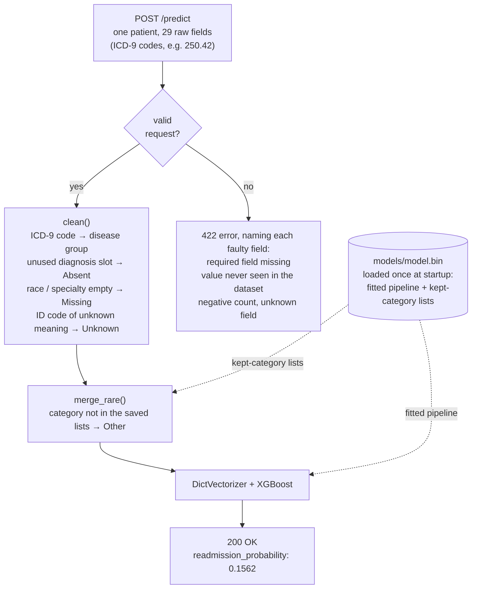
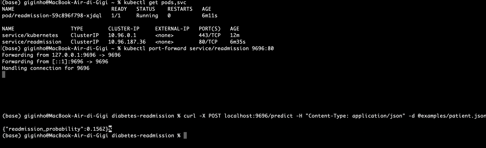

# Diabetes 30-day readmission

Predict whether a diabetic patient will be readmitted to hospital **within 30 days** of discharge, from the data of the hospital stay. ML Zoomcamp 2026 midterm project.

> Work in progress. Problem framing, EDA, model and service are added as the project grows.

## Problem

Hospitals in the US are penalised for early readmissions (Hospital Readmissions Reduction Program), and a readmission within 30 days is often a sign that the patient left hospital without enough support.

**Use case.** On the day of discharge, the model gives each diabetic patient a probability of being readmitted within 30 days. The hospital's care-transition team (nurses, case managers, pharmacists) cannot call, visit or review the medication of every patient, so it uses the score to rank the day's discharges and spend its limited capacity on the patients most likely to come back.

- **Target:** `readmitted == '<30'` (binary; 9.0% of the encounters after scoping). Readmissions after 30 days count as negative.
- **Metric:** ROC AUC, because the team acts on a ranking and the classes are imbalanced (always predicting "no readmission" is already 91% accurate).
- **Features:** only information available at discharge (demographics, admission data, length of stay, lab results, medications and their changes during the stay, diagnoses).
- **Bar in practice:** hospitals already use simple clinical scores such as the LACE index for this task.

## Data

[Diabetes 130-US Hospitals for years 1999–2008](https://archive.ics.uci.edu/dataset/296) (UCI Machine Learning Repository, dataset 296): 101,766 hospital encounters of 71,518 patients across 130 US hospitals, 50 columns.

- Licence: [CC BY 4.0](https://creativecommons.org/licenses/by/4.0/). The raw files are committed in `data/raw/`.
- Source paper: Strack B. et al. (2014), *Impact of HbA1c Measurement on Hospital Readmission Rates: Analysis of 70,000 Clinical Database Patient Records*, BioMed Research International, [doi:10.1155/2014/781670](https://doi.org/10.1155/2014/781670).

| File | Content |
| --- | --- |
| `data/raw/diabetic_data.csv` | one row per encounter |
| `data/raw/IDS_mapping.csv` | meaning of `admission_type_id`, `discharge_disposition_id`, `admission_source_id` |

To download them again: `uv run python scripts/download_data.py`.

### Scoping rules

Following the source paper:

1. **One encounter per patient**, so the same patient cannot appear in both training and validation data.
2. **Drop encounters that ended in death or hospice** (`discharge_disposition_id` 11, 13, 14, 19, 20, 21): these patients cannot be readmitted.
3. **Group the ICD-9 diagnosis codes** (`diag_1`, `diag_2`, `diag_3`) into about 9 disease categories.

Rule 1 uses the lowest `encounter_id` as the first encounter (the data has no dates; the notebook checks that the id order is consistent with time order). The 3 rows with `gender` = `Unknown/Invalid` are also dropped. Result: **69,970 encounters**, one per patient (the paper reports 69,984; the difference of 14 rows, 0.02%, is documented in the notebook).

## Limitations

- **The model predicts risk; it does not estimate the effect of any intervention.** It says who is likely to come back, not whether a follow-up call would prevent it. That is a causal question, the one the source paper addresses.
- **The `readmitted` label comes with the dataset, and its exact definition is not documented.** It appears to count returns to hospital that are not in the extract themselves (for example a stay longer than 14 days, or one without a diabetes diagnosis), while readmissions the source database never recorded (after the end of 2008, or at other hospitals) are probably labelled as no readmission.
- **Readmission depends on factors that are not in the data** (support at home, adherence to treatment, socio-economic situation), which limits the achievable performance.
- **The data covers 1999–2008.** Clinical practice and coding have changed since (the US moved from ICD-9 to ICD-10 in 2015), so a real deployment would need retraining on recent data.

## Prediction service

`src/diabetes_readmission/predict.py` is a FastAPI service that scores one discharged patient per request. The request
holds the raw fields of the hospital record; the service prepares them with the same code as training
(`features.py`), so a patient sent to the API is treated exactly like the patients the model learned from.



**Required and optional fields.** `race`, `medical_specialty` and `diag_1` to `diag_3` may be left out or sent as
`null`: they are often not recorded in the hospital data too (`medical_specialty` is empty for about half of the
patients), so the model has learned what "not recorded" means for them. Every other field is required, and a request
without one is rejected with a 422 error naming the missing fields. The training data has no missing values in those
fields, so the model has never seen a patient without them, and filling in a guessed value would silently change the
risk it returns.

## Run with Docker

The image contains only the runtime dependencies, the package and the trained model (`models/model.bin`). It is about
1.2 GB, most of it the CUDA libraries that the Linux `xgboost` wheel always includes; the CPU-only `xgboost-cpu` wheel
would remove them but has no macOS build, so the same package is kept everywhere for now.

```bash
docker build -t diabetes-readmission .
docker run -it --rm -p 9696:9696 diabetes-readmission
```

In a second terminal, score the example patient (a real patient from the test set):

```bash
curl -X POST localhost:9696/predict -H "Content-Type: application/json" -d @examples/patient.json
# {"readmission_probability":0.1562}
```

Or open <http://localhost:9696/docs> and use "Try it out" on `/predict`: the request body is pre-filled with the same
patient. `GET /health` returns the SHA-256 of the loaded model file.

## Deploy to Kubernetes

The same image runs on a local Kubernetes cluster created with [kind](https://kind.sigs.k8s.io/) (Kubernetes in
Docker). `k8s/deployment.yaml` runs the service in one pod, with health checks on `/health` and memory sized from a
measurement (about 340 MB with the model loaded); `k8s/service.yaml` gives the pods one stable address.

```bash
kind create cluster --name diabetes-readmission
docker build -t diabetes-readmission:v1 .
kind load docker-image diabetes-readmission:v1 --name diabetes-readmission   # copy the local image into the cluster
kubectl apply -f k8s/
kubectl rollout status deployment/readmission                                 # wait until the pod is ready
kubectl port-forward service/readmission 9696:80                              # forward localhost:9696 to the service
```

In a second terminal, the same request as with Docker:

```bash
curl -X POST localhost:9696/predict -H "Content-Type: application/json" -d @examples/patient.json
# {"readmission_probability":0.1562}
```



To remove the cluster afterwards: `kind delete cluster --name diabetes-readmission`.

## Project structure

```text
├── data/raw/                  raw data (CC BY 4.0)
├── examples/patient.json      example request for the service
├── images/                    figures used in this README
├── k8s/                       Kubernetes deployment and service (kind)
├── models/                    trained model (model.bin) and its metadata
├── notebooks/                 EDA and model selection
├── scripts/                   data download
├── src/diabetes_readmission/
│   ├── features.py            data preparation shared by training and the service
│   ├── train.py               trains the final model and saves models/model.bin
│   └── predict.py             FastAPI service
├── tests/                     unit tests (features) and API tests (service)
├── Dockerfile                 service image
├── pyproject.toml             dependencies (uv)
└── uv.lock                    locked versions
```

## Setup

Requires [uv](https://docs.astral.sh/uv/).

```bash
uv sync                                                        # runtime + dev (notebook, tests) dependencies
uv run python -m diabetes_readmission.train                    # retrain, print the test AUC, save models/model.bin
uv run pytest -q                                               # unit and API tests
uv run uvicorn diabetes_readmission.predict:app --port 9696    # start the service; try it at localhost:9696/docs
```
